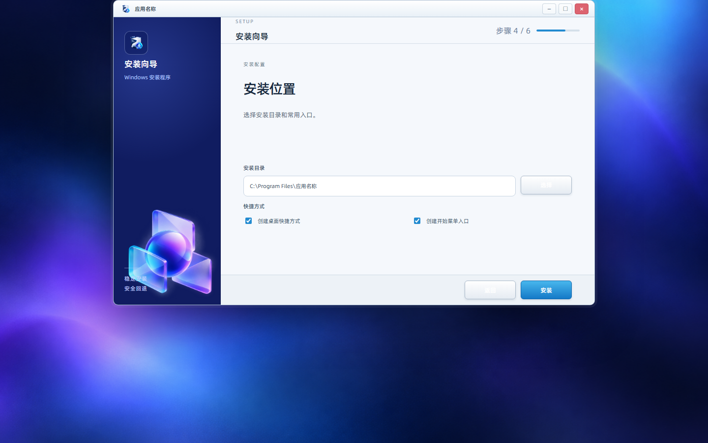
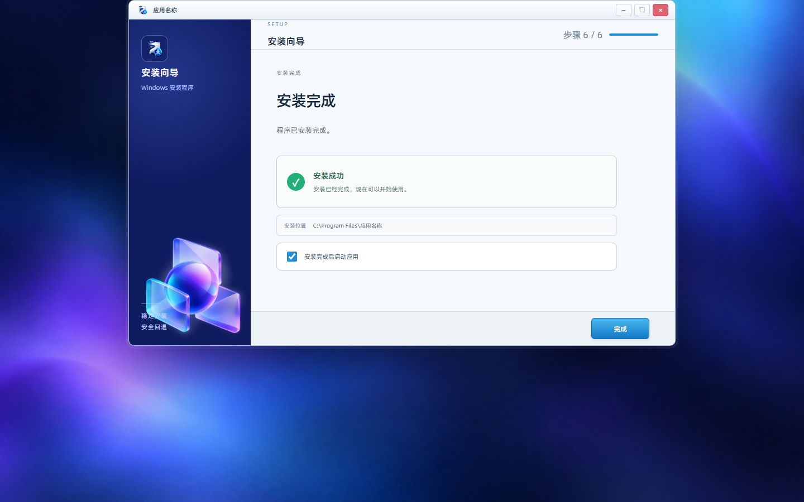
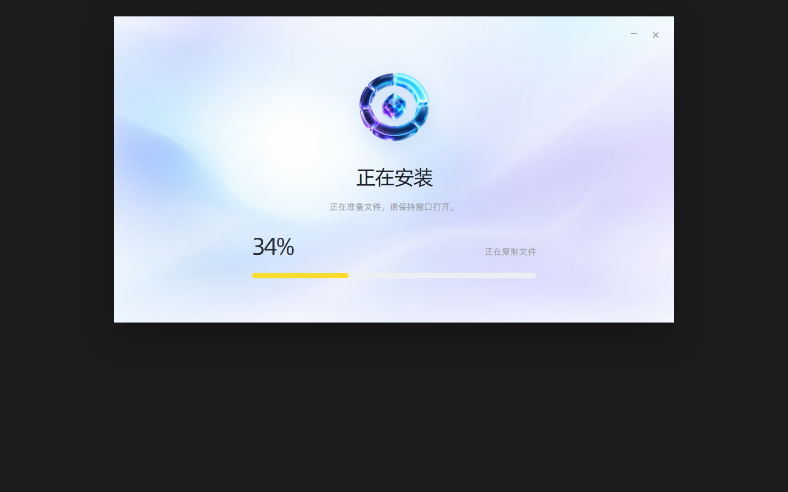
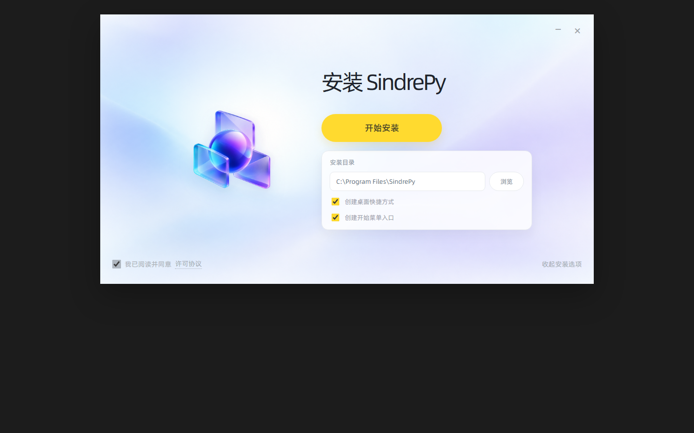

# SindreInstallerUI

SindreInstallerUI 是一个面向 Windows 软件的通用安装器主题项目，目标是使用 **NSIS + Modern UI 2（MUI2）** 提供稳定、可复用的安装、升级和卸载流程。

项目当前处于 **开发中**。现阶段优先确定原生 NSIS/MUI2 的页面结构、资源规范和安装流程，暂不维护自定义 DLL 主题运行时。

`SindrePy` 只是原型中的示例产品名。最终接入其他软件时，应替换产品名称、版本号、图标、许可协议、安装目录和实际 payload。

## 目标特性

当前 Python API 已实现以下能力：

- **支持 2GB 以上安装内容**：大体积 payload 不塞入单个传统 NSIS 数据块，改用安装包旁的外置分卷或分块文件，安装前检查旁路目录，安装过程中按块和归档 SHA-256 校验后提取。
- **支持 uv Python 环境**：把调用方提供的 Python 目录和项目文件放入 payload，安装时使用内置 uv 根据 `pyproject.toml`、`uv.lock` 同步依赖，也可以按指定版本准备 Python。
- **支持首次安装和升级**：NSIS 使用固定安装目录和卸载注册表项，重复运行同一应用安装包即可覆盖升级。
- **支持静默部署**：NSIS 原生支持 `/S`，安装器和生成的卸载器都可以静默运行。
- **支持可选组件**：模板启用 MUI2 组件页，调用方可在后续模板扩展中拆分组件。
- **支持失败回退**：构建阶段记录 NSIS 日志；安装阶段由 NSIS 和 uv 返回码阻止继续安装。

## 当前方向

当前只推进原生 NSIS/MUI2 方案：

- 使用 NSIS 负责安装器打包、文件复制、注册表和卸载器生成。
- 使用 MUI2 提供欢迎、许可、组件、安装目录、安装进度和完成页面。
- 使用同一套脚本支持首次安装、已有版本升级和静默安装。
- 将产品信息、许可文本、图标、组件和 payload 作为脚本或资源配置维护。
- 保持安装器可以脱离 SindrePy、DuiLib 和自定义 UI DLL 独立构建。

## 开发状态

| 模块 | 状态 | 说明 |
| --- | --- | --- |
| Full 原型 | 已归档 | 用于记录完整安装流程和页面布局 |
| Simple 原型 | 已归档 | 用于记录精简安装流程和页面布局 |
| 原生 MUI2 页面 | 已实现 | `libs/templates/installer.nsi.template` 使用内置 MUI2 页面 |
| 安装流程 | 已验证 | 已验证首次安装、升级覆盖、静默安装和静默卸载 |
| 组件管理 | 基础实现 | 模板启用组件页，具体组件由 payload 和后续配置决定 |
| 图标和资源 | 已实现 | wheel 包含 NSIS、uv、默认图标、模板和许可证 |
| 自动化测试 | 基础实现 | 包含 API 单元测试及 Windows 实际编译、安装和旁路 payload 验证 |

当前 Python 包版本为 `0.1.0`，仍在开发中；生成的安装包应先在目标 Windows 环境和测试账号中验收。

## 原型页面

原型页面保存在 `bak` 中，直接打开对应的 `index.html`：

- Full：[`bak/preview/ui_full/index.html`](bak/preview/ui_full/index.html)
- Simple：[`bak/preview/ui_sample/index.html`](bak/preview/ui_sample/index.html)

本机路径：

```text
F:\My_Github\SindreInstallerUI\bak\preview\ui_full\index.html
F:\My_Github\SindreInstallerUI\bak\preview\ui_sample\index.html
```

这些页面用于确认视觉结构和页面状态，不作为当前安装器的运行时依赖。

## 原型截图

截图由上面两个 `index.html` 生成，统一放在 `tmp/screenshots`，按主题和页面分组。

### Full








### Simple







## 目录说明

```text
SindreInstallerUI/
├─ sindre_installer/        # Python API 包
│  └─ libs/                 # 内置 NSIS、uv、模板和默认资源
├─ bak/                    # 历史原型、自定义主题和旧源码
│  └─ preview/
│     ├─ ui_full/          # Full 原型 index.html
│     └─ ui_sample/        # Simple 原型 index.html
├─ third_party/nsis/       # NSIS 相关第三方文件
├─ tools/                  # 构建和验证工具
│  └─ nsis/                # NSIS 工具文件
├─ tmp/
│  └─ screenshots/         # README 使用的原型截图
└─ README.md
```

`bak` 中的内容只用于追溯和对照，不参与当前原生安装器运行。

## 原生安装器计划

### 1. 页面流程

标准安装流程按以下顺序实现：

```text
欢迎
  → 许可协议
  → 选择组件
  → 安装目录与快捷方式
  → 安装进度
  → 安装完成
```

同时提供：

- 检测已有安装并进入升级流程。
- 保留用户数据、配置和已有快捷方式。
- 安装失败时显示错误信息并清理已写入内容。
- 静默安装和静默卸载。
- 支持取消、返回和关闭窗口。

### 2. 组件模型

每个组件需要定义：

- 组件名称和说明。
- 是否必选。
- 安装文件或目录。
- 占用空间。
- 是否支持升级时保留。
- 组件被取消时需要清理的文件。

核心运行库等基础组件应设为必选，开发工具、SDK、示例和文档可以作为可选组件。

### 3. 产品配置

后续会把以下内容集中到产品配置区域：

- 产品名称和发布者。
- 版本号。
- 安装目录默认值。
- 安装器图标和卸载器图标。
- 许可协议文本。
- 开始菜单和桌面快捷方式。
- 是否注册 Windows 服务。
- 是否设置开机自启。
- 安装完成后是否启动应用。

### 4. 验证范围

每次调整页面或脚本后，需要至少验证：

1. 新安装能正确写入 payload。
2. 安装目录、快捷方式和注册表信息正确。
3. 再次运行安装包能识别已有版本。
4. 升级不会删除用户数据和配置。
5. 卸载后文件、快捷方式和注册表项清理完成。
6. 静默参数不会弹出交互页面。
7. 取消和异常路径不会留下半安装状态。

## 构建说明

Python API 会从 wheel 内定位固定版本的 NSIS 和 uv，不要求调用方预先安装工具。仓库中的原始工具目录仍保留用于审计：

```text
F:\My_Github\SindreInstallerUI\third_party\nsis
F:\My_Github\SindreInstallerUI\tools\nsis
```

正式 Python 构建入口为 `sindre_installer.build_installer`，不提供独立 CLI。

## 历史内容

`bak` 保存切换到原生 NSIS/MUI2 前的内容，包括：

- Full 和 Simple HTML 原型。
- 自定义 DLL 主题及其 XML、图片和字体资源。
- `SindreInstallerUI.dll` 插件源码。
- DuiLib、CMake、旧构建目录和历史发布产物。

这些内容保留用于视觉比对和实现追溯，不属于当前正在开发的原生安装器版本。

## Python API 打包器

当前原生构建入口是 `sindre_installer` Python 包，不提供独立 CLI。包内自带固定版本的 NSIS 和 uv，调用方不需要预先安装这两个工具。

支持两类应用目录：

- 常规 Windows 程序：目录中有 `DemoApp.exe`、DLL 和资源目录时，传入 `executable=Path("DemoApp.exe")`，自动使用原生 EXE 启动。
- Python/uv 程序：目录中有 `main.py`、模块、资源和配置时，传入 `executable=Path("main.py")`，自动使用内置 uv 启动；也可以不传 `executable`，并设置 `run_mode="uv"` 与 `python_entrypoint="main.py"`。uv 模式不需要另写 `launcher.exe`，安装器会生成 `run-app.cmd`。

`run_mode="auto"` 按启动文件后缀选择模式：`.py` 使用 uv，`.exe` 使用原生启动。依赖同步在 NSIS 安装页内自动执行，安装页会显示 Python 环境、依赖（例如 numpy）和完成状态；uv 控制台不会单独弹出。

`source="official"` 使用官方 PyPI，`source="tsinghua"` 使用清华源并在失败时依次尝试阿里云、腾讯云、中科大、华为云，最后回退到官方 PyPI；`source="domestic"` 使用同一组国内候选源，`source="custom"` 需要同时提供 `uv_index_url` 和 `pip_index_url`。源地址会写入安装脚本的 `uv sync`/`uv pip sync`，并写入 Python 应用的 `run-app.cmd`。

最简调用只需要传入启动文件，版本默认为 `1.0.0`，输出目录默认为 `dist`，应用名和 payload 目录会自动推断：

```python
from pathlib import Path
from sindre_installer import pack_exe

# F:/Demo/build/Release/DemoApp.exe 旁边的 DLL、assets、config 会一起打包
result = pack_exe(Path("F:/Demo/build/Release/DemoApp.exe"))

# .py 自动使用 uv，F:/Demo/app 下的模块和资源会一起打包
result = pack_exe(Path("F:/Demo/app/main.py"), source="domestic")
print(result.installer_path)
```

需要完整控制时再使用配置对象：

```python
from pathlib import Path
from sindre_installer import InstallerConfig, build_installer

result = build_installer(InstallerConfig(
    app_name="DemoApp",
    version="2.0.0",
    executable=Path("dist/DemoApp.exe"),
    output_dir=Path("release"),
    payload_dir=Path("dist/app"),
    source="official",
))
```

支持的源配置为 `official`、`tsinghua`、`domestic` 和 `custom`。国内源会在当前源返回 403、超时或解析失败时自动按候选顺序重试，全部国内源失败后回退到官方 PyPI。安装器也支持 `/SINDRE_SOURCE=official`、`/SINDRE_SOURCE=tsinghua`、`/SINDRE_UV_INDEX=` 和 `/SINDRE_PIP_INDEX=` 参数覆盖默认源。

当项目包含 `pyproject.toml` 时，安装阶段调用内置 uv 同步项目；`uv.lock` 作为解析输入使用，但允许在切换软件源时更新 registry 元数据。只有 `requirements.txt` 时使用 `uv pip sync`。指定 `python_version` 后，安装器可以在目标机通过 uv 准备 Python 环境。

payload 小于阈值时直接嵌入 NSIS 安装包；超过阈值时生成安装器和旁路分块目录，安装器会在复制前校验旁路 payload。旁路目录必须和安装器一起分发。

构建 wheel：

```powershell
uv build --wheel
```

Python API 目前处于开发中，调用前需要在 Windows 环境验证目标 EXE、Python 依赖和网络源。
