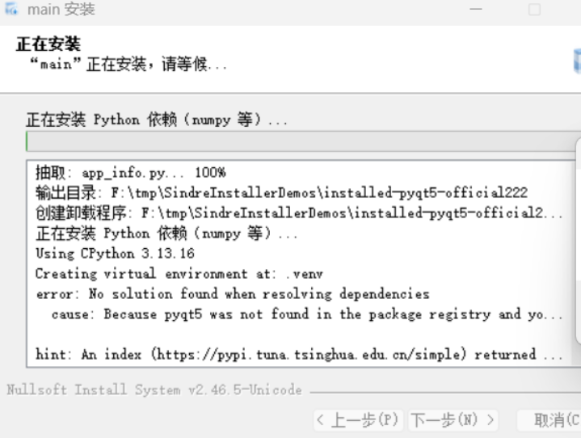

# SindreInstallerUI

一个面向 Windows 的通用安装器构建包。

它使用 **NSIS + MUI2** 生成安装包，支持普通 EXE 程序，也支持 Python/uv 项目。调用方只需要提供一个启动文件，安装器会把同目录下的 DLL、资源和配置一起打包。

> 当前版本仍在开发中，适合测试和内部发布。正式发布前请在目标 Windows 环境上重新验收。

## 你可以用它做什么

| 输入程序 | 传入的文件 | 安装时的启动方式 |
| --- | --- | --- |
| 普通 Windows 程序 | `DemoApp.exe` | 直接启动 EXE，不携带 uv |
| Python/uv 程序 | `main.py` | 使用内置 uv 创建环境并运行 Python |

安装器还支持：

- 首次安装、覆盖升级和卸载
- 静默安装：`/S`
- MUI2 欢迎、许可、组件、目录、进度和完成页面
- 2GB 以上 payload 的旁路分卷模式
- Python 依赖安装进度显示
- 国内镜像失败后自动切换其他镜像，最后回退官方 PyPI

## 5 分钟快速开始

### 1. 安装构建包

在 Windows 终端执行：

```powershell
uv pip install .
```

包内已经包含 NSIS、uv、模板和默认资源，不需要单独安装 `makensis.exe`。

### 2. 打包普通 EXE 程序

假设目录如下：

```text
F:\Demo\build\Release\
├─ DemoApp.exe
├─ DemoApp.dll
├─ thirdparty.dll
├─ assets\
└─ config\
```

Python 调用：

```python
from pathlib import Path
from sindre_installer import pack_exe

result = pack_exe(
    Path(r"F:\Demo\build\Release\DemoApp.exe"),
    Path(r"F:\Demo\release"),
)
print(result.installer_path)
```

结果是一个 NSIS 安装包，例如：

```text
F:\Demo\release\DemoApp-1.0.0-setup.exe
```

`DemoApp.exe` 同目录下的 DLL、`assets` 和 `config` 会一起复制。普通 EXE 模式不会把 `uv.exe` 放进安装目录。

### 3. 打包 Python/uv 程序

假设目录如下：

```text
F:\Demo\app\
├─ main.py
├─ pyproject.toml
├─ uv.lock
├─ modules\
├─ assets\
└─ config\
```

Python 调用：

```python
from pathlib import Path
from sindre_installer import pack_exe

result = pack_exe(
    Path(r"F:\Demo\app\main.py"),
    Path(r"F:\Demo\release"),
    source="domestic",
)
print(result.installer_path)
```

安装阶段会：

1. 复制 Python 源码、模块、资源和配置。
2. 复制内置 `uv.exe`。
3. 根据 `pyproject.toml` 和 `uv.lock` 创建 `.venv`。
4. 自动安装 PyQt5、numpy 等依赖。
5. 生成 `run-app.cmd`，用于启动程序。

不需要另外编写 `launcher.exe`。

## 软件源策略

`source="domestic"` 和 `source="tsinghua"` 的尝试顺序是：

```text
清华源
  → 阿里云
  → 腾讯云
  → 中科大
  → 华为云
  → 官方 PyPI
```

任意一个源成功，安装继续；全部源失败，安装器才会停止并显示错误。

可用配置：

| 配置 | 作用 |
| --- | --- |
| `official` | 只使用官方 PyPI |
| `domestic` | 国内候选源，最后回退官方 PyPI |
| `tsinghua` | 清华源优先，失败后使用同一组候选源 |
| `custom` | 使用调用方提供的自定义 uv/pip 源 |

自定义源示例：

```python
from pathlib import Path

from sindre_installer import pack_exe

result = pack_exe(
    Path(r"F:\Demo\app\main.py"),
    Path(r"F:\Demo\release"),
    source="custom",
    uv_index_url="https://example.com/uv/simple",
    pip_index_url="https://example.com/pip/simple",
)
```

安装器也支持运行时覆盖：

```text
/SINDRE_SOURCE=official
/SINDRE_SOURCE=domestic
/SINDRE_UV_INDEX=https://example.com/simple
/SINDRE_PIP_INDEX=https://example.com/simple
```

## 两种模式的区别

### 普通 EXE 模式

- 启动文件后缀是 `.exe`
- 直接复制并启动 EXE
- 不执行 uv
- 不安装 Python 依赖
- 不携带 `uv.exe`

### Python/uv 模式

- 启动文件后缀是 `.py`
- 自动使用内置 uv
- 依赖在安装阶段同步
- 安装失败会阻止完成安装
- 安装完成页可以启动 `run-app.cmd`

也可以显式指定：

```python
from pathlib import Path
from sindre_installer import InstallerConfig, build_installer

result = build_installer(
    InstallerConfig(
        app_name="DemoApp",
        version="2.0.0",
        executable=Path(r"F:\Demo\app\main.py"),
        output_dir=Path(r"F:\Demo\release"),
        source="domestic",
    )
)
```

## 演示项目

本地演示项目位于：

```text
F:\tmp\SindreInstallerDemos
```

目录中包含：

```text
SindreInstallerDemos\
├─ pyqt5_app\       # PyQt5 + uv 源码项目
├─ native_app\      # EXE + DLL + assets/config
├─ outputs\         # 已生成的安装包
└─ README.md         # 演示项目使用说明
```

PyQt5 自检：

```powershell
cd F:\tmp\SindreInstallerDemos\pyqt5_app
uv run --project . python main.py --self-test
```

原生程序编译和运行：

```powershell
cd F:\tmp\SindreInstallerDemos\native_app
.\build.ps1
.\build\Release\DemoApp.exe
```

## 当前开发状态

| 模块 | 状态 |
| --- | --- |
| 原生 NSIS/MUI2 页面 | 已实现 |
| 普通 EXE + DLL 打包 | 已验证 |
| Python/uv 自动依赖安装 | 已验证 |
| 国内源候选和官方回退 | 已实现并验证 |
| 首次安装、升级、卸载 | 已实现基础流程 |
| 静默安装和卸载 | 已验证 |
| 2GB+ 旁路 payload | 已实现基础流程 |
| Full/Simple 自定义主题 | 已归档，仅用于视觉参考 |

当前 Python 包版本：`0.1.0`。

## 原型和截图

Full 和 Simple 原型已经归档，不参与当前安装器运行：

- [Full 原型](bak/preview/ui_full/index.html)
- [Simple 原型](bak/preview/ui_sample/index.html)

截图位于 [`tmp/screenshots`](tmp/screenshots)。使用折叠区域查看，避免 README 页面被大图撑开。

### Full 主题

<details>
<summary>展开 Full 页面截图</summary>

<p></p>
<p></p>
<p></p>
<p></p>
<p></p>
<p></p>
<p></p>

</details>

### Simple 主题

<details>
<summary>展开 Simple 页面截图</summary>

<p></p>
<p></p>
<p></p>
<p></p>
<p></p>

</details>

### Python 依赖安装日志

<p></p>

这张图记录的是旧安装包在清华源不可用时的失败日志。当前版本会继续尝试国内候选源，最后回退到官方 PyPI。

## 项目目录

```text
SindreInstallerUI\
├─ sindre_installer\        # Python API 包
│  └─ libs\                  # NSIS、uv、模板、默认资源和许可证
├─ tests\                    # API 单元测试
├─ tools\                    # 本地验证工具
├─ third_party\              # 第三方工具审计文件
├─ bak\                      # 历史原型和旧主题源码
└─ tmp\screenshots\         # README 使用的截图
```

`bak` 只用于视觉比对和历史追溯，不参与当前原生安装器运行。

## 构建和测试

构建 wheel：

```powershell
uv build --wheel
```

运行测试：

```powershell
uv run --no-project python -m unittest discover -s tests -v
```

构建入口是 Python 函数，不提供独立 CLI：

```python
from sindre_installer import pack_exe, build_installer
```

NSIS、uv、模板和默认图标会从包内自动定位。修改安装脚本后，应至少验证：

1. 新安装能写入完整 payload。
2. Python 依赖可以成功安装。
3. 再次运行可以覆盖升级。
4. 卸载能清理程序文件和注册表项。
5. 静默参数不会弹出交互页面。
6. 失败和取消不会留下半安装状态。

## 历史内容

`bak` 保存早期的 Full/Simple HTML 原型、自定义 DLL 主题、DuiLib、CMake 和旧构建产物。它们保留用于实现追溯，不属于当前原生 NSIS/MUI2 方案。
